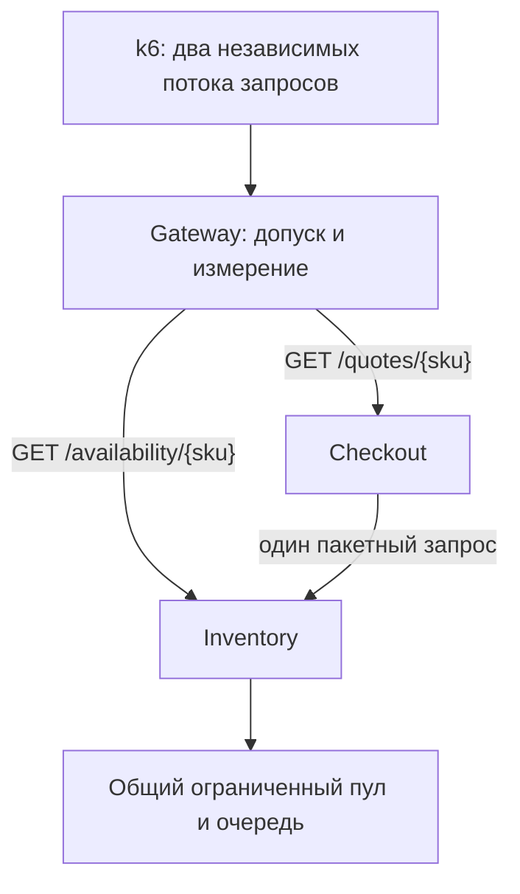

# Adaptive Gateway

Экспериментальный шлюз для исследования перегрузки в микросервисной системе. Проект проверяет, может ли изменение числа одновременно пропускаемых запросов сохранить качество обслуживания одного маршрута, когда другой начинает занимать общий ресурс слишком надолго.

## Какую проблему решаем

Две операции — быстро проверить наличие товара и получить оценку комплекта — используют один ограниченный пул рабочих потоков. Если пакетная операция замедляется, она дольше занимает потоки. Короткие проверки наличия начинают ждать в общей очереди, хотя их собственная работа остаётся быстрой.

Шлюз ограничивает число одновременно выполняемых запросов на оценку комплекта. Когда свободных мест нет, новый запрос сразу получает отказ. Это уменьшает давление на общий ресурс, но создаёт потери для ограничиваемого маршрута. Поэтому оценивается качество обслуживания обоих маршрутов.

## Планируемая архитектура



- **Gateway** принимает внешние запросы, измеряет исходы и регулирует допуск `quotes`.
- **Checkout** обрабатывает `quotes` через один пакетный вызов Inventory.
- **Inventory** выполняет короткие и пакетные операции в общем пуле. В эксперименте замедляется пакетная работа.

Стенд использует фиксированные данные. Занятость рабочих слотов моделируется синтетической работой; перенос результатов на реальную базу данных или вычислительную нагрузку требует отдельной проверки.

## Какие предположения проверяются

1. **Перегрузка передаётся через общий ресурс.** Замедление пакетных операций может ухудшать обслуживание коротких запросов. Сначала это должно подтвердиться на стенде без прикладного ограничения.
2. **Постоянный лимит способен защитить короткий маршрут.** Проверяется, какой ценой для пропуска пакетных запросов достигается эта защита.
3. **Адаптация может улучшить соотношение защиты и потерь при изменении состояния системы.** Проверяется, насколько меняющийся лимит полезнее подобранного постоянного ограничения и как влияет на восстановление.

Преимущество адаптации не считается доказанным заранее. Если постоянный лимит окажется не хуже или лучше, это тоже результат исследования.

## Сравниваемые режимы

| Режим | Как пропускаются quotes |
|---|---|
| B0 | Без прикладного ограничения числа одновременных запросов |
| B1 | С постоянным лимитом, выбранным на отдельном пилоте |
| B2 | С лимитом, который изменяется по состоянию системы |

Во всех режимах сохраняются одинаковые конечные ресурсы сервера и транспорта. У `availability` отдельного прикладного ограничителя в базовом стенде нет.

В B2 основной сигнал — время ответа защищаемого `availability`; также учитываются инфраструктурные ошибки. После устойчивого ухудшения шлюз уменьшает лимит `quotes`. Когда защищаемый маршрут работает хорошо и есть спрос, лимит постепенно увеличивается. Конкретные пороги проверяются на пилоте и фиксируются до основной серии.

## Как оценивается результат

Запланированы нормальная нагрузка и сценарий «норма → замедление пакетной операции → восстановление». Для маршрутов создаются независимые потоки запросов. Сохраняются исход каждого запроса, фактические границы фаз и внутренние показатели ресурса и лимита.

**Полезный ответ** — корректный HTTP 200 с ожидаемым телом, полученный не позднее установленного SLO, то есть порога допустимого времени ответа. Поздний 200 и быстрый отказ полезными ответами не считаются.

Основные показатели:

- Доля полезных ответов среди всех начатых запросов каждого маршрута.
- Goodput — число полезных ответов в секунду.
- Причины и доли отказов, задержки корректных ответов.
- Время восстановления после снятия замедления и поведение лимита.

Главное сравнение — изменение полезной доли `availability` в B2 относительно B1 при замедлении. Вместе с ним показываются потери `quotes`, чтобы защита одного маршрута не скрывала ухудшение другого. Настройка проводится отдельно от основной серии; итоговые выводы должны восстанавливаться из исходных данных.

## Технологии

Java 21, Spring Boot MVC, Maven Wrapper и синхронный HTTP-клиент с конечными таймаутами. Для локального стенда предусмотрен Docker Compose, для нагрузки — k6, для анализа JSONL-результатов — Python и matplotlib.

Базовая работа ограничена одним компьютером, двумя маршрутами и одним общим ресурсом. Тема исследования — ограничение распространения перегрузки в таком стенде.

## Текущее состояние

Подготовлены постановка исследования и структура работы. В коде пока есть только начальное Spring Boot MVC-приложение. Три сервиса, маршруты, общий пул, B0/B1/B2 и экспериментальные сценарии ещё предстоит реализовать. Результатов сравнения пока нет.

На первом этапе проверены версии локальных инструментов: Java 21.0.2, Maven Wrapper с Maven 3.10.0, Docker Compose 2.40.0-desktop.1, k6 2.4.0 и Python 3.13.17. Это проверка доступности инструментов; совместимость зависимостей сборкой и работоспособность стенда пока не подтверждены. При проверке Docker CLI не смог подключиться к локальному Engine.

Для проверки Java и Maven Wrapper в PowerShell из корня проекта:

```powershell
java -version
.\mvnw.cmd -v
```

Команды сборки и запуска стенда, примеры запросов и воспроизведения эксперимента будут добавляться по мере готовности соответствующих частей.
