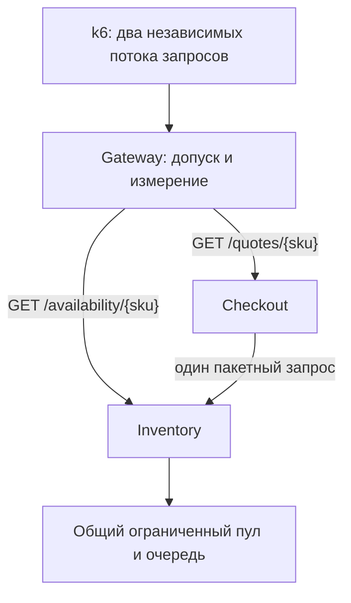

# Adaptive Gateway

Экспериментальный шлюз для исследования перегрузки в микросервисной системе. Проект проверяет, может ли изменение числа одновременно пропускаемых запросов сохранить качество обслуживания одного маршрута, когда другой начинает занимать общий ресурс слишком надолго.

## Какую проблему решаем

Две операции — быстро проверить наличие товара и получить оценку комплекта — используют один ограниченный пул рабочих потоков. Если пакетная операция замедляется, она дольше занимает потоки. Короткие проверки наличия начинают ждать в общей очереди, хотя их собственная работа остаётся быстрой.

Шлюз ограничивает число одновременно выполняемых запросов на оценку комплекта. Когда свободных мест нет, новый запрос сразу получает отказ. Это уменьшает давление на общий ресурс, но создаёт потери для ограничиваемого маршрута. Поэтому оценивается качество обслуживания обоих маршрутов.

## Планируемая архитектура



- **Gateway** принимает внешние запросы, измеряет исходы и регулирует допуск `quotes`.
- **Checkout** обрабатывает `quotes` через один пакетный вызов Inventory.
- **Inventory** выполняет короткие и пакетные операции в общем пуле. В эксперименте замедляется пакетная работа.

Стенд использует фиксированные данные. Занятость рабочих слотов моделируется синтетической работой; перенос результатов на реальную базу данных или вычислительную нагрузку требует отдельной проверки.

## Какие предположения проверяются

1. **Перегрузка передаётся через общий ресурс.** Замедление пакетных операций может ухудшать обслуживание коротких запросов. Сначала это должно подтвердиться на стенде без прикладного ограничения.
2. **Постоянный лимит способен защитить короткий маршрут.** Проверяется, какой ценой для пропуска пакетных запросов достигается эта защита.
3. **Адаптация может улучшить соотношение защиты и потерь при изменении состояния системы.** Проверяется, насколько меняющийся лимит полезнее подобранного постоянного ограничения и как влияет на восстановление.

Преимущество адаптации не считается доказанным заранее. Если постоянный лимит окажется не хуже или лучше, это тоже результат исследования.

## Сравниваемые режимы

| Режим | Как пропускаются quotes |
|---|---|
| B0 | Без прикладного ограничения числа одновременных запросов |
| B1 | С постоянным лимитом, выбранным на отдельном пилоте |
| B2 | С лимитом, который изменяется по состоянию системы |

Во всех режимах сохраняются одинаковые конечные ресурсы сервера и транспорта. У `availability` отдельного прикладного ограничителя в базовом стенде нет.

В B2 основной сигнал — время ответа защищаемого `availability`; также учитываются инфраструктурные ошибки. После устойчивого ухудшения шлюз уменьшает лимит `quotes`. Когда защищаемый маршрут работает хорошо и есть спрос, лимит постепенно увеличивается. Конкретные пороги проверяются на пилоте и фиксируются до основной серии.

## Как оценивается результат

Запланированы нормальная нагрузка и сценарий «норма → замедление пакетной операции → восстановление». Для маршрутов создаются независимые потоки запросов. Сохраняются исход каждого запроса, фактические границы фаз и внутренние показатели ресурса и лимита.

**Полезный ответ** — корректный HTTP 200 с ожидаемым телом, полученный не позднее установленного SLO, то есть порога допустимого времени ответа. Поздний 200 и быстрый отказ полезными ответами не считаются.

Основные показатели:

- Доля полезных ответов среди всех начатых запросов каждого маршрута.
- Goodput — число полезных ответов в секунду.
- Причины и доли отказов, задержки корректных ответов.
- Время восстановления после снятия замедления и поведение лимита.

Главное сравнение — изменение полезной доли `availability` в B2 относительно B1 при замедлении. Вместе с ним показываются потери `quotes`, чтобы защита одного маршрута не скрывала ухудшение другого. Настройка проводится отдельно от основной серии; итоговые выводы должны восстанавливаться из исходных данных.

## Технологии

Java 21, Spring Boot MVC 4.1.2 и Maven Wrapper с Maven 3.10.0. Совместимость версий описана в [требованиях Spring Boot](https://docs.spring.io/spring-boot/system-requirements.html) и [требованиях Maven](https://maven.apache.org/docs/3.10.0/release-notes.html).

Для исходящих запросов выбран синхронный `RestClient` с Apache HttpClient 5.6.5; версию клиента задаёт BOM Spring Boot 4.1.2. В собранных приложениях используется Spring Framework 7.0.10. MVC соответствует последовательному HTTP-пути стенда. Apache позволяет явно ограничивать пул и отдельно задавать ожидание соединения из пула, установление соединения и чтение ответа. См. [адаптер Spring для Apache HttpClient](https://docs.spring.io/spring-framework/docs/current/javadoc-api/org/springframework/http/client/HttpComponentsClientHttpRequestFactory.html).

Клиенты используют конечные таймауты: соединение и ожидание пула — по 100 мс, ожидание ответа Inventory — 650 мс, Checkout — 850 мс. Пул клиента ограничен 100 соединениями всего и на маршрут. Автоматические повторы и перенаправления отключены. Эти ограничения одинаковы для будущих B0/B1/B2. Таймаут чтения не равен общему дедлайну вызова: полная проверка медленного чтения тела предусмотрена на неделе 3.

Для локального стенда предусмотрен Docker Compose, для нагрузки — k6, для анализа JSONL-результатов — Python и matplotlib.

Базовая работа ограничена одним компьютером, двумя маршрутами и одним общим ресурсом. Тема исследования — ограничение распространения перегрузки в таком стенде.

## Текущее состояние

Подготовлены постановка исследования и Maven-сборка трёх приложений. Корневой POM объединяет модули, каждый из которых содержит собственную точку входа и собирается в отдельный исполняемый JAR. Зависимостей между кодом сервисов нет.

```text
adaptive-gateway/
├── pom.xml
├── gateway/       # приём внешних запросов и будущий контроль допуска
├── checkout/      # один пакетный вызов Inventory
└── inventory/     # общий ограниченный ресурс
```

Внутри приложений код расположен по назначению. `controller` содержит HTTP-маршруты, `dto` — форматы запросов и ответов, `config` — настройки компонентов, `error` — обработку ошибок. В Checkout и Inventory пакет `service` содержит логику операций. В Inventory пакет `execution` отвечает за задачи, очередь, дедлайны и отмену. Пакет `monitoring` сохраняет снимки ресурсов, а в Gateway также учитывает вызовы маршрутов. Точка входа каждого приложения находится в корневом пакете. Тесты повторяют структуру пакетов приложения.

Три приложения запускаются независимо. Actuator предоставляет health, liveness и readiness на основном порту каждого процесса. Реализованы два сквозных GET-маршрута, фиксированные данные, общий ограниченный executor Inventory и управляемое замедление batch. Следующие этапы добавят режимы B0/B1/B2 и нагрузочные сценарии.

Проверены Java 21.0.2, Maven Wrapper с Maven 3.10.0, Docker Engine 28.5.1 (Linux), Docker Compose 2.40.0-desktop.1, k6 2.4.0 и Python 3.13.17. Для первоначальных HTTP-маршрутов проверен повторный запуск трёх контейнеров через Compose.

Проверка окружения и сборка из корня проекта в PowerShell:

```powershell
java -version
.\mvnw.cmd -v
docker info
k6 version
.\mvnw.cmd clean verify
```

Сборка создаёт `gateway/target/gateway-0.0.1-SNAPSHOT.jar`, `checkout/target/checkout-0.0.1-SNAPSHOT.jar` и `inventory/target/inventory-0.0.1-SNAPSHOT.jar`. Для сборки одного приложения можно выполнить `.\mvnw.cmd -pl gateway -am verify` из корня (аналогично для `checkout` и `inventory`). Тесты проверяют контекст Gateway, HTTP-вызовы Gateway/Checkout, ответы Inventory, переполнение общей очереди, таймаут и базовую отмену работы.

## Запуск и проверка приложений

После сборки откройте три отдельных терминала PowerShell в корне репозитория и выполните по одной команде в каждом:

```powershell
java -jar gateway/target/gateway-0.0.1-SNAPSHOT.jar
```

```powershell
java -jar checkout/target/checkout-0.0.1-SNAPSHOT.jar
```

```powershell
java -jar inventory/target/inventory-0.0.1-SNAPSHOT.jar
```

| Приложение | Порт по умолчанию | Переменная окружения для порта |
|---|---:|---|
| Gateway | 8080 | GATEWAY_PORT |
| Checkout | 8081 | CHECKOUT_PORT |
| Inventory | 8082 | INVENTORY_PORT |

В четвёртом терминале проверьте готовность:

```powershell
curl.exe --fail --silent --show-error http://localhost:8080/actuator/health/readiness
curl.exe --fail --silent --show-error http://localhost:8081/actuator/health/readiness
curl.exe --fail --silent --show-error http://localhost:8082/actuator/health/readiness
```

Ожидается HTTP 200 и JSON `{"status":"UP"}`. На тех же портах доступны `/actuator/health` и `/actuator/health/liveness`. Readiness отражает готовность самого процесса; доступность соседних приложений и выполнение бизнес-запроса в неё не входят. По HTTP опубликован только health, детали скрыты. Чтобы остановить приложение, нажмите Ctrl+C в его терминале.

Пример смены порта Inventory перед запуском:

```powershell
$env:INVENTORY_PORT = '18082'
java -jar inventory/target/inventory-0.0.1-SNAPSHOT.jar
# После остановки приложения:
Remove-Item Env:INVENTORY_PORT
```

Для будущих исходящих запросов подготовлены параметры:

| Где | Свойство | Переменная окружения | Значение по умолчанию |
|---|---|---|---|
| Gateway | upstream.checkout.base-url | CHECKOUT_BASE_URL | http://localhost:8081 |
| Gateway и Checkout | upstream.inventory.base-url | INVENTORY_BASE_URL | http://localhost:8082 |

Параметры адресов используются HTTP-клиентами. При смене порта сервиса его адрес у вызывающего приложения нужно менять отдельно.

## Контракт маршрутов

Фиксированный SKU — `SKU-001`, остаток — 10 единиц, цена оценки — 100.00 RUB.

| Запрос Gateway | Путь | Ответ 200 |
|---|---|---|
| `GET /availability/SKU-001` | Gateway → Inventory | `{"sku":"SKU-001","available":true,"quantity":10}` |
| `GET /quotes/SKU-001` | Gateway → Checkout → Inventory | `{"sku":"SKU-001","available":true,"price":100.00,"currency":"RUB"}` |

Checkout выполняет ровно один `GET /internal/batch-availability?sku=SKU-001`. Batch возвращает `items` с одним элементом наличия; в текущем минимальном стенде комплект содержит один фиксированный SKU. Цена фиксирована, базы данных нет.

Неизвестный SKU возвращает HTTP 404 с полями `code=not_found` и `message`. Инфраструктурные 502/503/504 передаются по цепочке; ошибка соединения обозначается `502 upstream_transport`, таймаут — `504 upstream_timeout`. Корректные ответы, ошибки, разрыв соединения, отсутствие повторов и перенаправлений проверяются HTTP-тестами на локальном stub.

## Автоматическая проверка запуска на Windows

Остановите запущенные вручную приложения, чтобы освободить порты. Из корня выполните:

```powershell
.\scripts\smoke-health.ps1
```

Скрипт проверяет свободные порты, запускает собранные JAR, ожидает readiness с ограничением времени, проверяет три health endpoint и закрытость `/actuator/env`. Затем останавливает Inventory и проверяет независимость readiness оставшихся приложений. В конце, в том числе при ошибке, завершает созданные им процессы. Полная сборка перед этой проверкой выполняется командой `.\mvnw.cmd clean verify`.

Переопределение портов для проверки:

```powershell
.\scripts\smoke-health.ps1 -GatewayPort 18080 -CheckoutPort 18081 -InventoryPort 18082
```

Оба набора портов проверены успешно. Логи каждого запуска сохраняются в `target/health-smoke/<идентификатор>/` и исключены из Git. Проверка относится к запуску и health; измерений производительности пока нет.

## Запуск через Docker Compose

Нужны Java 21, доступ к Maven Central и запущенный Docker Engine с Compose. Сначала соберите актуальные JAR; Dockerfile копирует их из target и сам Maven не запускает:

```powershell
.\mvnw.cmd clean verify
docker compose config --quiet
docker compose up -d --build --wait --wait-timeout 120
.\scripts\smoke-routes.ps1
docker compose ps
```

Публикуется только Gateway на `127.0.0.1:8080`; Checkout и Inventory доступны внутри сети Compose. Их readiness проверяется контейнерными healthcheck, а depends_on ожидает готовности зависимостей. Подробнее: [порядок запуска Compose](https://docs.docker.com/compose/how-tos/startup-order/).

Образ Java закреплён как `eclipse-temurin:21.0.9_10-jre-jammy` с digest `sha256:cc11c035bb25cc709d7b1e3f43cbff15d69e06e2dba23eec431b64627d27e705`. Приложения работают под UID 10001; каждому контейнеру задано 1 CPU и 512 MiB памяти. Локальные образы приложений имеют тег week1; это рабочие сборки, а не замороженная экспериментальная версия.

Для другого порта Gateway задайте `$env:GATEWAY_HOST_PORT = '18080'` до запуска, затем проверяйте `.\scripts\smoke-routes.ps1 -BaseUrl http://localhost:18080`. Внутренние порты и адреса при этом не меняются.

Примеры запросов:

```powershell
curl.exe --fail http://localhost:8080/availability/SKU-001
curl.exe --fail http://localhost:8080/quotes/SKU-001
```

Остановка и удаление только ресурсов этого проекта:

```powershell
docker compose down
```

Для проверки воспроизводимости снова выполните up с --build и --wait, затем smoke-routes. Для просмотра ошибок используйте `docker compose logs --no-color`. Первый и повторный запуск проверены с обоими маршрутами и неизвестным SKU. При запуске без контейнеров полный smoke выполняется командой `.\scripts\smoke-health.ps1 -CheckRoutes`.

## Путь запроса и границы текущей реализации

Servlet-контроллер Gateway принимает HTTP-запрос в потоке Tomcat. Для availability он синхронно вызывает Inventory. Для quotes он вызывает Checkout, который делает один пакетный HTTP-запрос в Inventory и формирует фиксированную оценку. Три процесса независимы; общих объектов Java между ними нет.

Inventory ставит каждую операцию в один общий `ThreadPoolExecutor` с 8 воркерами и FIFO-очередью на 16 задач. `availability` занимает слот примерно на 15 мс, batch — на 45 мс. Задержка через прерываемый `sleep` моделирует занятость ограниченного ресурса. Servlet-поток ждёт результат, пока отдельный воркер выполняет задачу. Каждый маршрут ставит ровно одну задачу.

При заполнении очереди Inventory сразу отвечает `503 inventory_overload`. На очередь и работу вместе выделено 450 мс по монотонным часам. Истечение срока даёт `504 inventory_deadline`, отменяет задачу с прерыванием и удаляет её из очереди, если она ещё ожидает. Эти коды обрабатывает `ApiExceptionHandler`. Счётчик активной работы уменьшается в `finally` самой задачи после её выхода. Проверены отмена в очереди и во время исполнения, прерывание ожидающего обработчика и отказ от запуска просроченной задачи. Перенос перегрузки и эффект ограничения будут оценены на нагрузочных измерениях.

Checkout проверяет, что пакетный ответ содержит один непустой элемент с ожидаемым SKU. Некорректный ответ, включая `items: [null]`, приводит к `502 upstream_transport`.

## Нагрузочный генератор пилота B0

`experiments/load.js` создаёт независимые потоки quotes и availability через k6 constant-arrival-rate. Одна итерация выполняет один GET. Начальный вход — 50 и 15 запросов/с, клиентский timeout — 1200 мс, время завершения начатых итераций после прекращения входа — до 3 с. Для каждого запроса записываются отдельные события start и result. Результат содержит время начала/конца, статус, проверку тела, категорию исхода и полезность по SLO 280/100 мс.

Для короткой функциональной проверки на работающем Gateway выполнить следующие команды.

```powershell
New-Item -ItemType Directory -Force target/load-smoke
k6 run --log-format raw --console-output target/load-smoke/events.jsonl -e DURATION_SECONDS=5 -e SUMMARY_FILE=target/load-smoke/summary.json experiments/load.js
```

Начала и результаты имеют общий requestId. Сводка k6 отдельно считает старты, завершения и dropped_iterations. `python experiments/check_load.py target/load-smoke --duration 5` проверяет полноту и полезность исходов. Валидатор требует dropped_iterations=0 и совпадения событий с независимыми счётчиками. Отклонение числа стартов от RPS × длительность на границе сценария допускается до одного запроса и выводится явно. Фазы назначаются по времени начала запроса.

## Снимки ресурсов и учёт вызовов

При включённом `SNAPSHOTS_ENABLED=true` каждый сервис пишет JSONL-снимки в отдельный файл. Интервал между записями составляет примерно секунду. `SNAPSHOT_FILE` задаёт путь, `RUN_ID` — идентификатор проверки или будущего прогона. При запуске JAR пути по умолчанию — `target/snapshots/gateway.jsonl`, `checkout.jsonl`, `inventory.jsonl`. Для включения можно передать `--observability.snapshots.enabled=true` при запуске Java. Servlet-пулы всех трёх приложений ограничены 100 потоками.

В Compose запись включена. Файлы находятся в `/tmp/snapshots/` каждого контейнера. Перед `docker compose down` сохранить их на хост следующими командами.

```powershell
New-Item -ItemType Directory target/snapshots-export
docker compose cp gateway:/tmp/snapshots/gateway.jsonl target/snapshots-export/gateway.jsonl
docker compose cp checkout:/tmp/snapshots/checkout.jsonl target/snapshots-export/checkout.jsonl
docker compose cp inventory:/tmp/snapshots/inventory.jsonl target/snapshots-export/inventory.jsonl
```

Каждая строка содержит `schemaVersion=1`, `service`, `runId`, уникальный `instanceId` процесса, `sequence`, серверное `epochMs` и монотонное `uptimeMs`. Запись дописывает файл. Перезапуск создаёт новый instanceId и начинает sequence с 1. Ошибка доступа к файлу при запуске останавливает старт приложения с включённой записью. Ошибка последующей записи попадает в журнал приложения, пропущенный номер sequence позволяет обнаружить потерю снимка.

| Поля | Смысл |
|---|---|
| `servlet` во всех сервисах | Фактические busy/current/max из стандартных метрик Tomcat. `null` означает, что измеритель пока недоступен. |
| `httpPool`, `httpRoutes` в Gateway/Checkout | Занятые (`leased`), ожидаемые (`pending`) и свободные соединения, лимит пула. Также сохраняются значения по адресам upstream. |
| `inventory` | Активные задачи, длина очереди, лимиты 8/16, накопленные accepted/rejected/deadlineExceeded и executorCompleted, текущий fault с revision и временем применения. |
| `routes.AVAILABILITY`, `routes.QUOTES` в Gateway | started/completed/active, накопленные исходы и суммарное/максимальное время вызовов в миллисекундах. |

`accepted` и `rejected` Inventory относятся к постановке задач для существующего SKU. `deadlineExceeded` включает прерванное ожидание обработчика. `executorCompleted` — стандартный счётчик завершённых исполнителем Runnable, включая отменённые задачи, которые успели попасть в исполнение. Активность и очередь снимаются последовательно и могут измениться между чтениями.

В Gateway исходы представлены как `success`, `http_<статус upstream>`, `transport_error` и `unexpected_error`. `transport_error` включает таймаут, обрыв, ошибку чтения или проверки тела. Каждый вызов учитывается до получения и проверки всего тела, затем уменьшает active и увеличивает completed даже при ошибке. Счётчики каждого маршрута согласованы под короткой блокировкой, HTTP выполняется вне неё.

Эти длительности измеряются внутри Gateway. Клиентскую полезность по SLO предстоит считать по данным k6. Накопленные total/max предназначены для диагностики, оконная статистика B2 появится на этапе адаптации.

## Переключение замедления Inventory

В Compose включён локальный административный маршрут `POST /internal/fault?enabled=true|false`. Он доступен внутри сети стенда. Параметр `enabled` обязателен. Включение задаёт новым batch-задачам 200 мс работы, выключение возвращает 45 мс. Availability занимает 15 мс при обоих профилях.

После запуска Compose выполнить из корня проекта следующие команды.

```powershell
docker compose exec -T inventory curl --fail --silent -X POST "http://localhost:8080/internal/fault?enabled=true"
docker compose exec -T inventory curl --fail --silent -X POST "http://localhost:8080/internal/fault?enabled=false"
```

Ответ содержит `enabled`, `appliedEpochMs` с серверным временем применения в миллисекундах Unix и `revision`. Счётчик revision растёт при каждом успешном вызове и начинается заново при перезапуске Inventory. Время берётся внутри той же блокировки, которая согласует смену профиля и постановку batch-задач. Каждая принятая задача сохраняет свою длительность и revision. Поэтому после выключения fault ранее принятые задачи ещё могут завершаться с задержкой 200 мс.

Для отдельного JAR маршрут включается параметром `--inventory.fault-control.enabled=true`. Локальный запуск с этим параметром выполнять с `--server.address=127.0.0.1`. По умолчанию отдельный JAR отвечает на административный маршрут 404.

Сборка `verify` проверяет контракт fault, сохранение профиля и гонку переключения с постановкой. Для проверки передачи 503/504 через собранные Gateway и Checkout доступен отдельный скрипт с управляемым HTTP stub Inventory. Требуется Python 3 и предварительная сборка JAR.

```powershell
python scripts/smoke-error-chain.py
```

Скрипт проверяет оба маршрута и ровно один вызов Inventory на каждый запрос, сохраняет логи в `target/error-chain-smoke/` и завершает запущенные им процессы.

Введение и обзор строятся на следующих источниках. Это рабочий список для проекта, который предстоит дополнить академическими исследованиями и оформить по требованиям ВКР:

| Источник | Для чего используется |
|---|---|
| [Google SRE: Addressing Cascading Failures](https://sre.google/sre-book/addressing-cascading-failures/) | Распространение отказов при исчерпании ресурсов и опасность усиления нагрузки повторами |
| [Google SRE: Handling Overload](https://sre.google/sre-book/handling-overload/) | Отказы при перегрузке и ограничение нагрузки |
| [Spring: RestClient](https://docs.spring.io/spring-framework/reference/7.0/web/webmvc-client.html) | Синхронная модель исходящих HTTP-вызовов |
| [Apache HttpClientBuilder](https://hc.apache.org/httpcomponents-client-5.6.x/current/httpclient5/apidocs/org/apache/hc/client5/http/impl/classic/HttpClientBuilder.html) | Отключение retries и redirects |
| [Java 21: ThreadPoolExecutor](https://docs.oracle.com/en/java/javase/21/docs/api/java.base/java/util/concurrent/ThreadPoolExecutor.html) | Следующий этап: конечные ресурсы, очередь и отказ при переполнении |
| [Docker Compose: Startup order](https://docs.docker.com/compose/how-tos/startup-order/) | Readiness зависимостей при запуске стенда |
| [k6: Built-in metrics](https://grafana.com/docs/k6/latest/using-k6/metrics/reference/) | Будущая методика: состав задержки, завершения запросов и dropped_iterations |

Источники просмотрены 21.11.2026. Их документация обосновывает инженерные решения, но не подтверждает будущий выигрыш B2.
